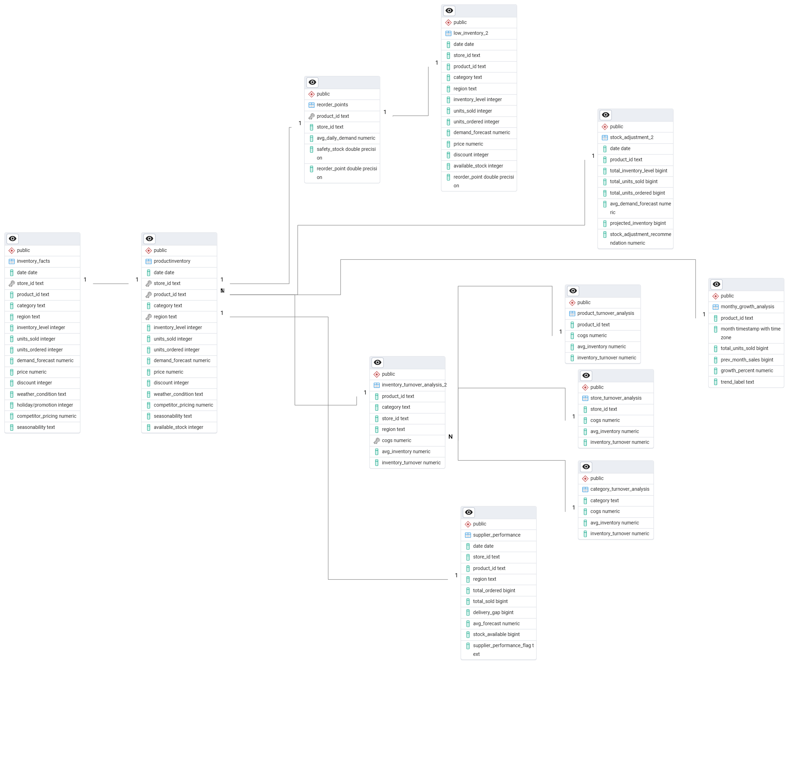

# Inventory Optimization & Supply Chain Analytics

A PostgreSQL and Power BI analytics solution built to diagnose inventory inefficiencies, optimize replenishment decisions, evaluate supplier performance, and monitor multi-store KPIs for **Urban Retail Co.**

Developed as part of **Urban Retail Co. — Solving Inventory Inefficiencies Using SQL** (*Consulting & Analytics Club, IIT Guwahati — Summer Projects '25*, **Team Helios**).

---

## Business Problem & Objectives

Rapidly scaling retail chains with regional warehouses feeding multiple physical and online outlets face persistent operational bottlenecks when inventory decisions rely on reactive, manual processes:

- **Frequent Stockouts:** Fast-moving SKUs run out of stock, causing missed sales and degraded customer experience.
- **Overstocking & Holding Costs:** Slow-moving items tie up working capital and inflate warehousing expenses.
- **Blind Spots in Replenishment & Suppliers:** Limited visibility into SKU velocity, reorder thresholds, and supplier fulfillment reliability.
- **Fragmented Visibility:** Lack of unified reporting across product categories, stores, and regions.

### Project Goals
1. Structure raw daily retail operations data in a query-optimized PostgreSQL schema.
2. Quantify inventory turnover and Cost of Goods Sold (COGS) across products, stores, categories, and regions.
3. Automate stock adjustment recommendations (both categorical flags and daily unit quantities) against forecasted demand.
4. Track supplier delivery gaps and flag potential overstock or supplier-driven stockout risks.
5. Deliver an interactive Power BI KPI dashboard and executive summary for operational decision-making.

---

## Repository Structure

```text
Inventory-Optimization/
├── assets/
│   └── erd_2.png                              # PostgreSQL schema Entity-Relationship Diagram
├── dashboard/
│   └── kpi_dashboard.pbix                     # 6-page Power BI Desktop KPI dashboard
├── docs/
│   ├── SQL_Report.pdf                         # 2-page Executive Summary presentation (Team Helios)
│   └── Urban_Retail_Summer_Projects_25.pdf    # Problem statement & project deliverables brief
├── sql/
│   ├── 01_schema_setup.sql                    # Base DDL (inventory_facts, productinventory) & indexes
│   ├── 02_turnover_analysis.sql               # Product, store, category, and granular turnover tables
│   ├── 03_stock_optimization.sql              # Categorical & daily quantitative stock adjustments
│   └── 04_supplier_performance.sql            # Delivery gap calculation & supplier risk flags
├── .gitignore
└── README.md
```

---

## Database Architecture & Schema

The analytical pipeline runs on PostgreSQL (`public` schema) and centers on two foundational fact tables that feed downstream aggregation and optimization tables.



### Base Tables (`sql/01_schema_setup.sql`)
- **`inventory_facts`**: Daily store-product transaction and operational snapshot containing `date`, `store_id`, `product_id`, `category`, `region`, `inventory_level`, `units_sold`, `units_ordered`, `demand_forecast`, `price`, `discount`, `weather_condition`, `"holiday/promotion"`, `competitor_pricing`, and `seasonality`.
- **`productinventory`**: Enriched inventory table extending `inventory_facts` with `available_stock` (`integer`), indexed on `store_id`, `category`, and `(product_id, category, region, store_id)` for analytical query performance.

### SQL Output Tables (`sql/02`–`sql/04`)
| Table | Source | Script | Purpose |
| :--- | :--- | :--- | :--- |
| `product_turnover_analysis` | `productinventory` | `02_turnover_analysis.sql` | Product-level COGS, average inventory, and turnover ratio |
| `store_turnover_analysis` | `productinventory` | `02_turnover_analysis.sql` | Store-level COGS, average inventory, and turnover ratio |
| `category_turnover_analysis` | `productinventory` | `02_turnover_analysis.sql` | Category-level COGS, average inventory, and turnover ratio |
| `inventory_turnover_analysis_2` | `productinventory` | `02_turnover_analysis.sql` | Multi-dimensional turnover (`product_id`, `category`, `store_id`, `region`) |
| `stock_adjustment_recommendations` | `productinventory` | `03_stock_optimization.sql` | Categorical stock status (`Reduce Stock`, `Increase Stock`, `Stock Level Optimal`) |
| `stock_adjustment` | `inventory_facts` | `03_stock_optimization.sql` | Daily `projected_inventory` and unit-level restock/reduce recommendations |
| `supplier_performance` | `inventory_facts` | `04_supplier_performance.sql` | Daily store/product/region `delivery_gap` and supplier performance flags |

> **Note on Additional ERD & Dashboard Tables:** As shown in [`assets/erd_2.png`](assets/erd_2.png) and modeled in [`dashboard/kpi_dashboard.pbix`](dashboard/kpi_dashboard.pbix), the full Power BI semantic model also incorporates `reorder_points`, `low_inventory_2`, `stock_adjustment_2`, and `monthy_growth_analysis` alongside the core SQL scripts included in `sql/`.

---

## SQL Analytics & Optimization Logic

### 1. Inventory Turnover & COGS (`sql/02_turnover_analysis.sql`)
Uses CTE pipelines to compute approximate Cost of Goods Sold and inventory turnover at four levels of granularity (product, store, category, and product × category × store × region), guarding against division by zero:

- `COGS = SUM(units_sold * price)`
- `inventory_turnover = COGS / AVG(inventory_level)` (when `avg_inventory > 0`, otherwise `NULL`)

High turnover coupled with high COGS highlights top-performing SKUs, while high average inventory paired with low turnover flags slow-moving or potential deadstock items.

### 2. Stock Adjustment & Replenishment (`sql/03_stock_optimization.sql`)
Provides both strategic classification and operational daily order sizing:

- **Categorical SKU-Region Health (`stock_adjustment_recommendations`):**
  - `Reduce Stock` when `SUM(units_sold) < AVG(inventory_level) * 0.5`
  - `Increase Stock` when `SUM(units_sold) > AVG(inventory_level) * 1.5`
  - `Stock Level Optimal` otherwise
- **Daily Quantitative Adjustment (`stock_adjustment`):**
  - Computes `projected_inventory = inventory_level - units_sold`
  - If `projected_inventory < demand_forecast`, recommends restocking `CEIL(demand_forecast - projected_inventory)` units
  - If `inventory_level > demand_forecast * 1.5`, recommends reducing future orders by `-CEIL(inventory_level - demand_forecast * 1.2)` units
  - Otherwise outputs `0` (optimal level)

### 3. Supplier Performance & Delivery Gap (`sql/04_supplier_performance.sql`)
Aggregates daily procurement vs. sales by `date`, `store_id`, `product_id`, and `region`:

- `delivery_gap = SUM(units_ordered - units_sold)`
- Compares ordered volume, sold volume, available stock, and average forecasted demand:
  - `Possible Overstock` when `SUM(units_ordered) - SUM(units_sold) > 30`
  - `Possible Stockout (Supplier Delay)` when `SUM(units_ordered) - SUM(units_sold) < -30`
  - `Normal` otherwise

---

## Power BI Dashboard & Executive Insights

The 6-page Power BI report ([`dashboard/kpi_dashboard.pbix`](dashboard/kpi_dashboard.pbix)) and executive summary ([`docs/SQL_Report.pdf`](docs/SQL_Report.pdf)) cover retail operations from **January 2022 to December 2023** across stores **`S001`–`S005`** and regions **`East`**, **`North`**, **`South`**, and **`West`**:

1. **Reorder Points & Low Inventory Trends:** Compares `reorder_point` across stores (`S001`–`S004`) and tracks `inventory_level` against `reorder_point` over time by category and SKU, exposing store-level threshold inconsistencies as well as seasonal stockout dips and overstock spikes.
2. **Monthly Product Growth (`monthy_growth_analysis`):** Tracks month-over-month `growth_percent` across 2022–2023 to spotlight consistent growth performers (such as `P0016` and `P0046`), seasonal spikes, and demand saturation dips.
3. **COGS, Turnover & Average Inventory (`inventory_turnover_analysis_2`):** Combines stacked store inventory bars with COGS and turnover lines to separate high-velocity revenue drivers from capital-locking deadstock candidates.
4. **Forecast vs. Inventory vs. Stock Adjustments (`stock_adjustment_2`):** Evaluates `avg_demand_forecast` against `total_inventory_level` and `stock_adjustment_recommendation` to guide SKU-level rebalancing.
5. **Supplier Performance Benchmarking (`supplier_performance`):** Breaks down `avg_forecast`, `total_ordered`, and `total_sold` per store across `Normal`, `Possible Overstock`, and `Possible Stockout (Supplier Delay)` flags.
6. **Regional Delivery Gap Diagnostics (`supplier_performance`):** Maps `delivery_gap` across products, stores, and regions to pinpoint persistent negative under-delivery gaps and logistics bottlenecks.

---

## Getting Started

### Prerequisites
- **PostgreSQL** (14+ recommended)
- **Power BI Desktop** (to open and refresh [`dashboard/kpi_dashboard.pbix`](dashboard/kpi_dashboard.pbix))

### Running the SQL Pipeline
1. Create a PostgreSQL database and initialize the base schema and indexes:
   ```bash
   psql -d <your_database> -f sql/01_schema_setup.sql
   ```
2. Load your source dataset into `inventory_facts` (and populate `productinventory` with `available_stock`).
3. Execute the analytical transformation scripts in order:
   ```bash
   psql -d <your_database> -f sql/02_turnover_analysis.sql
   psql -d <your_database> -f sql/03_stock_optimization.sql
   psql -d <your_database> -f sql/04_supplier_performance.sql
   ```
4. Open [`dashboard/kpi_dashboard.pbix`](dashboard/kpi_dashboard.pbix) in Power BI Desktop and update the PostgreSQL data source connection to point to your local database.

---

## Tech Stack
- **Database & Analytics:** PostgreSQL, SQL (CTEs, aggregations, conditional logic, indexing)
- **BI & Visualization:** Power BI Desktop
- **Documentation & Reporting:** Entity-Relationship Modeling, Executive Summary Deck

## Author
**Jinay Mehta** — Team Helios
